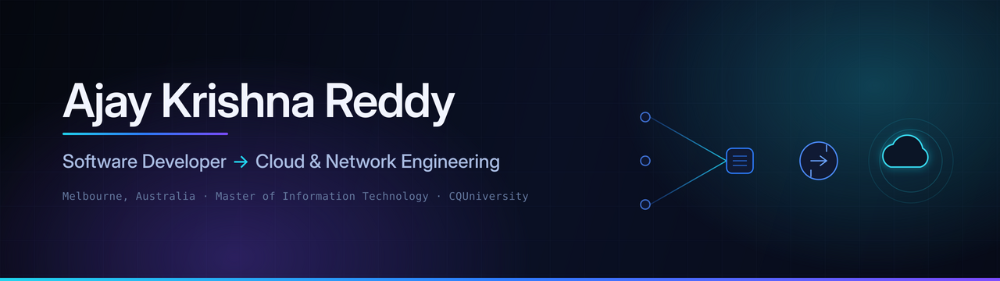

<div align="center">
  
</div>

<div align="center">

[](https://linkedin.com/in/ajay-krishna-reddy)
[](mailto:ajaykrishnareddy1@gmail.com)
[](#)

</div>

---

## About me

I'm a software developer based in **Melbourne, Australia**, currently studying a **Master of Information Technology at CQUniversity**, majoring in Networks and Information Security with a minor in Artificial Intelligence.

I started in front-end development — building React applications professionally in India, then delivering freelance websites for real businesses here in Australia. I'm now deliberately moving toward **cloud infrastructure, networking and DevOps**, because I'd rather build and run the systems underneath the product than only the surface.

What's on this profile is real work: client websites that shipped, a location-tracking application, e-commerce builds, and university networking projects.

```
Background      Electronics & Communication Engineering  →  React development
Now             Master of IT — Networks & Information Security  ·  CQUniversity Melbourne
Direction       Cloud infrastructure  ·  Networking  ·  DevOps
```

---

## What I work with

**Languages & Front-end**


**Backend, data & services**


**Infrastructure & tooling**


---

## Featured work

<table>
<tr>
<td width="50%" valign="top">

### TecWorkz
**Commercial client — live in production**

Corporate website for a Melbourne IT services company. Built and deployed end to end: React front-end, working contact form, custom domain and continuous deployment.

`React` `EmailJS` `Framer Motion` `Netlify`

[Repository →](https://github.com/AJAY2043/tecworkz)

</td>
<td width="50%" valign="top">

### Where Is My Foreman
**Real-time location tracking**

Web application letting site managers track field workers on a live map. Firebase realtime database, Google Maps integration and user authentication.

`React` `Firebase` `Google Maps API` `Express`

[Repository →](https://github.com/AJAY2043/foreman-project)

</td>
</tr>
<tr>
<td width="50%" valign="top">

### Run-Flat Systems
**Industrial product site**

Multi-page marketing site for a run-flat tyre manufacturer covering military, ambulance and cash-in-transit vehicle applications.

`React` `Formik` `Framer Motion` `Bootstrap`

[Repository →](https://github.com/AJAY2043/run-flat-systems)

</td>
<td width="50%" valign="top">

### Scamsters
**Community safety prototype**

Prototype platform for reporting and surfacing local scam activity, with report submission and moderated listing pages.

`React` `Firebase` `Formik` `Bootstrap`

[Repository →](https://github.com/AJAY2043/scamsters-prototype)

</td>
</tr>
</table>

---

## GitHub activity

<div align="center">


</div>

---

## Currently

- Working toward **Microsoft Certified: Azure Fundamentals (AZ-900)** — exam scheduled November 2026
- Studying network routing, switching and automation (GNS3 lab work) at CQUniversity
- **Student Member, Australian Computer Society (ACS)**
- **Victoria Region Representative**, CQUniversity Student Representative Council
- Open to **IT Support, Cloud and Network Engineering** opportunities in Melbourne

---

<div align="center">

### Let's connect

I'm always happy to talk about cloud infrastructure, networking, or front-end work —<br/>
and open to junior roles and collaboration in Melbourne.

[](https://linkedin.com/in/ajay-krishna-reddy)
[](mailto:ajaykrishnareddy1@gmail.com)

<sub>Built in Melbourne, Australia</sub>

</div>
